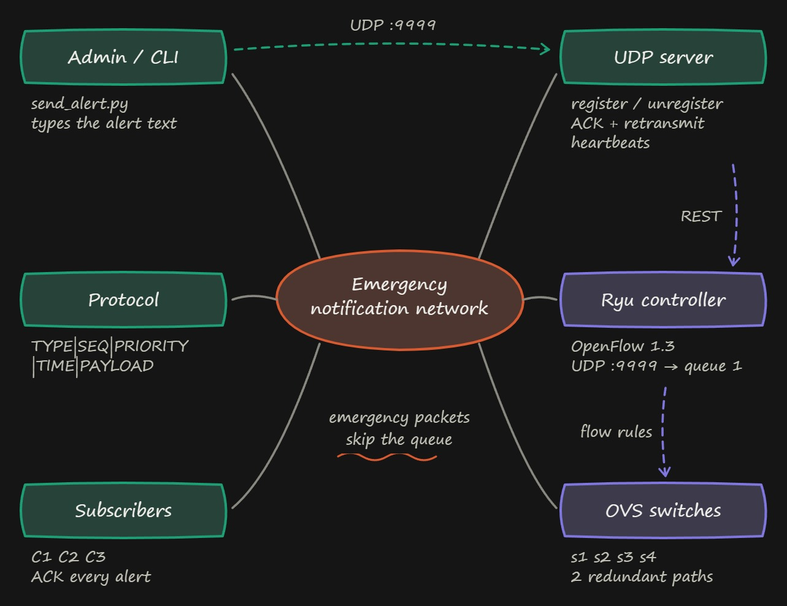
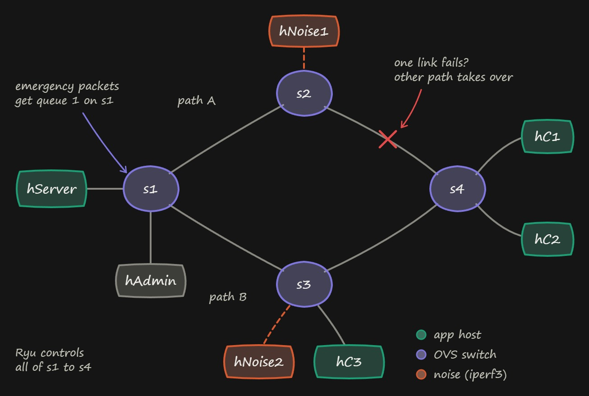

# Emergency Notification Network

A **UDP-based emergency notification system** deployed on **Mininet** with an **SDN controller (Ryu + OpenFlow 1.3)** that classifies, prioritizes, and dynamically manages emergency traffic.

## Problem Statement

During a network emergency, alert traffic must reach subscribers quickly — even when ordinary background traffic is saturating the network. This project implements an emergency notification service where the SDN controller recognizes emergency packets and gives them preferential forwarding.

## Architecture



### Topology



Two redundant paths (s1→s2→s4 and s1→s3→s4) allow rerouting on link failure.

## Protocol

All messages use `|`-delimited format:

```
TYPE|SEQ|PRIORITY|TIMESTAMP|PAYLOAD
```

| Type | Example |
|---|---|
| `REGISTER` | `REGISTER\|0\|NORMAL\|1727670000.124\|C1` |
| `ALERT` | `ALERT\|42\|HIGH\|1727670004.531\|FIRE IN BLOCK A` |
| `ACK` | `ACK\|42\|HIGH\|1727670004.781\|C1` |
| `UNREGISTER` | `UNREGISTER\|0\|NORMAL\|1727670100.220\|C1` |
| `HEARTBEAT` | `HEARTBEAT\|0\|NORMAL\|1727670102.004\|C1` |

## Software Requirements

- Ubuntu 20.04+ (or Mininet-compatible Linux)
- Python 3.8-3.11 (Ryu is supported on Python 3.11)
- Mininet 2.3+
- Open vSwitch 2.13+
- Ryu SDN Framework 4.34+
- `iperf3` (for background traffic)

## Installation

```bash
# Clone the repository
git clone https://github.com/AAK1767/emergency-notification-network.git
cd emergency-notification-network

# Install Python dependencies
pip3 install -r requirements.txt

# Mininet & OVS are typically system packages
sudo apt-get install mininet openvswitch-switch
```

## Native Ubuntu Setup

For the full Mininet demo, use a native Ubuntu installation or an Ubuntu VM.
Use `uv` for Python 3.11 because some Ubuntu releases do not provide
`python3.11` through apt.

```bash
sudo apt update
sudo apt install -y git curl mininet openvswitch-switch iperf3 xterm x11-xserver-utils

curl -LsSf https://astral.sh/uv/install.sh | sh
export PATH="$HOME/.local/bin:$PATH"
uv python install 3.11

git clone https://github.com/AAK1767/emergency-notification-network.git
cd emergency-notification-network

# Install the Python dependencies needed by the controller and applications.
uv venv --seed --python 3.11 .venv
source .venv/bin/activate
python -m pip install "pip==20.3.4" "setuptools==67.6.1" wheel "eventlet==0.33.3"
python -m pip install --no-build-isolation -r requirements.txt

python -c "import ryu; print('Ryu import OK')"
sudo service openvswitch-switch start
```

Open a second terminal, activate the virtual environment, and start the Ryu
controller:

```bash
cd emergency-notification-network
source .venv/bin/activate
python3 controller/run_ryu.py controller/ryu_app.py --observe-links --verbose
```

In a third terminal, start the Mininet topology:

```bash
cd emergency-notification-network
sudo mn -c
sudo python3 topology/topo.py
```

When `mininet>` appears, run the server, clients, and alert sender with
`python3`:

```text
mininet> hServer python3 server/server.py &
mininet> hC1 python3 client/client.py --id C1 --server 10.0.0.1 --port 9999 &
mininet> hC2 python3 client/client.py --id C2 --server 10.0.0.1 --port 9999 &
mininet> hC3 python3 client/client.py --id C3 --server 10.0.0.1 --port 9999 &
mininet> hAdmin python3 server/send_alert.py --server 10.0.0.1 --port 9999 -m "FIRE IN BLOCK A"
```

## Using WSL 2

WSL uses the same Python setup as native Ubuntu. The only WSL-specific change
is `--no-tc`, because WSL kernels may not support Mininet traffic-control
qdiscs.

If WSL is not installed, run this once from Administrator PowerShell:

```powershell
wsl --install -d Ubuntu
```

Then run this in Ubuntu:

```bash
sudo apt update
sudo apt install -y git curl mininet openvswitch-switch iperf3 xterm x11-xserver-utils

curl -LsSf https://astral.sh/uv/install.sh | sh
export PATH="$HOME/.local/bin:$PATH"
uv python install 3.11

git clone https://github.com/AAK1767/emergency-notification-network.git
cd emergency-notification-network

uv venv --seed --python 3.11 .venv
source .venv/bin/activate
python -m pip install "pip==20.3.4" "setuptools==67.6.1" wheel "eventlet==0.33.3"
python -m pip install --no-build-isolation -r requirements.txt
sudo service openvswitch-switch start
```

Use two WSL terminals. In terminal 1, start the controller:

```bash
cd ~/emergency-notification-network
source .venv/bin/activate
python3 controller/run_ryu.py controller/ryu_app.py --observe-links --verbose
```

In terminal 2, start the topology:

```bash
cd ~/emergency-notification-network
sudo mn -c
sudo python3 topology/topo.py --no-tc
```

When `mininet>` appears, run the server, clients, and alert sender. Replace
`/home/<user>/emergency-notification-network` with your repository path if
using a custom working directory:

```text
mininet> hServer python3 server/server.py &
mininet> hC1 python3 client/client.py --id C1 --server 10.0.0.1 --port 9999 &
mininet> hC2 python3 client/client.py --id C2 --server 10.0.0.1 --port 9999 &
mininet> hC3 python3 client/client.py --id C3 --server 10.0.0.1 --port 9999 &
mininet> hAdmin python3 server/send_alert.py --server 10.0.0.1 --port 9999 -m "FIRE IN BLOCK A"
```

## Repository Structure

```
├── config/
│   └── config.json          # Central configuration
├── common/
│   ├── protocol.py          # Message encoding / decoding
│   └── logger.py            # Timestamped logging
├── server/
│   ├── server.py            # Emergency notification server
│   ├── subscriber_manager.py
│   ├── alert_manager.py     # ACK tracking & retransmission
│   ├── controller_client.py # REST integration with Ryu
│   └── send_alert.py        # Standalone alert sender
├── client/
│   └── client.py            # Subscriber client
├── controller/
│   ├── run_ryu.py           # Python 3.11-compatible Ryu launcher
│   └── ryu_app.py           # Ryu SDN controller application
├── topology/
│   └── topo.py              # Mininet topology definition
├── tests/
│   ├── test_protocol.py     # Protocol + local E2E tests
│   └── test_gui.py          # Headless GUI validation tests
├── experiments/             # Experiment scripts (D2)
├── results/                 # Data & graphs (D2)
├── docs/                    # Extra documentation
├── run_demo.py              # Automated D1 demo
├── gui.py                   # Tkinter emergency alert dashboard
├── plan.md                  # Full project plan
└── requirements.txt
```

## Quick Start (D1 Demo)

The D1 demo showcases **end-to-end emergency notification delivery**:

```text
hAdmin sends an ALERT → hServer broadcasts it → hC1/hC2/hC3 receive it and send ACKs
```

The clients register with `hServer` first. The server then tracks each ACK and
reports when the alert has been acknowledged by all registered subscribers.

### Option A — Run the automated demo

This is the shortest way to run the complete D1 flow. Start the Ryu controller
in one terminal first, after activating the virtual environment:

```bash
source .venv/bin/activate
python controller/run_ryu.py controller/ryu_app.py --observe-links --verbose
```

In a second terminal, from the repository root, clean up any stale Mininet
state, then run the automated demo:

```bash
sudo mn -c
sudo python3 run_demo.py
```

For WSL kernels that do not support Mininet traffic-control qdiscs, use:

```bash
sudo mn -c
sudo python3 run_demo.py --no-tc
```

The demo intentionally uses Ubuntu's system `python3`, including for the
server, clients, and alert sender started inside Mininet. Mininet is installed
as an Ubuntu system package, so this avoids a separate virtual-environment
setup for the demo.

The demo adds a management/NAT interface at `10.0.0.254` so Mininet hosts can
reach the Ryu REST API at `10.0.0.254:8080`. OpenFlow still uses
`127.0.0.1:6653`; these are separate controller connections.

Run `sudo mn -c` again before retrying if the demo is interrupted or exits
without cleaning up the network.

`run_demo.py` automates the parts that are otherwise entered at the Mininet
prompt:

1. Creates and starts the D1 topology.
2. Runs `pingall` to verify host connectivity.
3. Starts `server/server.py` on `hServer`.
4. Starts clients `C1`, `C2`, and `C3` on `hC1`, `hC2`, and `hC3`.
5. Sends the fixed demo message `FIRE IN BLOCK A` from `hAdmin`.
6. Drops into the Mininet CLI so that commands such as `dump` and
   `ovs-ofctl dump-flows s1 -O OpenFlow13` can still be run interactively.

The script does not start the Ryu controller and does not open xterm windows;
those must be started separately if needed. It uses the repository's
system `python3` interpreter for the host processes.

To verify the REST path from the Mininet CLI, run:

```text
mininet> hServer ping -c 2 10.0.0.254
mininet> hServer wget -qO- --post-data='{"event":"test"}' --header='Content-Type: application/json' http://10.0.0.254:8080/api/event
```

If Ryu is not running, the UDP notification and ACK flow still works. The
server reports once that the optional REST event API is unavailable and then
skips further REST callbacks instead of printing a connection-refused warning
for every subscriber and alert.

### Verify the automated demo visibly

Watch the demo terminal for these two kinds of log lines. After the automated alert is sent, `run_demo.py` prints a **Delivery logs**
section containing the server log and each client log. Each client should
have an `ALERT received` line for the same sequence number, and the server
should have an `ACK ... received` line for each subscriber:

```text
[CLIENT:C1] ALERT received [SEQ=<n> PRIO=HIGH]: FIRE IN BLOCK A
[CLIENT:C2] ALERT received [SEQ=<n> PRIO=HIGH]: FIRE IN BLOCK A
[CLIENT:C3] ALERT received [SEQ=<n> PRIO=HIGH]: FIRE IN BLOCK A
[SERVER:ALERT] ACK seq=<n> received from C1
[SERVER:ALERT] ACK seq=<n> received from C2
[SERVER:ALERT] ACK seq=<n> received from C3
```

The timestamp prefix and the exact sequence number vary. The final
`All ACKs received for ALERT` server message confirms that the complete
delivery cycle finished. The script also prints the temporary log directory;
from the Mininet CLI you can recheck a log with, for example:

```text
mininet> hC1 cat /tmp/emergency-notification-demo-<pid>/C1.log
mininet> hServer cat /tmp/emergency-notification-demo-<pid>/server.log
```

To inspect the SDN rule from the Mininet CLI, run:

```text
mininet> sh ovs-ofctl dump-flows s1 -O OpenFlow13
```

Look for the flow matching `udp,tp_dst=9999` with `set_queue:1`. This checks
the emergency forwarding rule; the client and server log lines above check
actual notification delivery and ACKs.

### Option B — Run the D1 flow manually

Start the Ryu controller and topology as described above. For a manual
non-GUI run, start the server and clients from the `mininet>` prompt with
their output redirected to log files:

```text
mininet> hServer sh -c 'python3 server/server.py > /tmp/d1-server.log 2>&1' &
mininet> hC1 sh -c 'python3 client/client.py --id C1 --server 10.0.0.1 --port 9999 > /tmp/d1-C1.log 2>&1' &
mininet> hC2 sh -c 'python3 client/client.py --id C2 --server 10.0.0.1 --port 9999 > /tmp/d1-C2.log 2>&1' &
mininet> hC3 sh -c 'python3 client/client.py --id C3 --server 10.0.0.1 --port 9999 > /tmp/d1-C3.log 2>&1' &
```

Wait a few seconds for the clients to register, then send the alert:

```text
mininet> hAdmin python3 server/send_alert.py --server 10.0.0.1 --port 9999 -m "FIRE IN BLOCK A"
```

Print the captured logs directly in the Mininet CLI:

```text
mininet> hServer cat /tmp/d1-server.log
mininet> hC1 cat /tmp/d1-C1.log
mininet> hC2 cat /tmp/d1-C2.log
mininet> hC3 cat /tmp/d1-C3.log
```

You should see the server's three `ACK ... received` lines and one
`ALERT received` line in each client log. This verifies delivery without
opening xterms. To follow a log between commands, use:

```text
mininet> hServer tail -f /tmp/d1-server.log &
```

Stop that `tail` process with `Ctrl-C`, or clean up with `sudo mn -c` after
exiting the Mininet CLI.

### Troubleshooting: `No module named 'mininet'`

If `sudo python3 run_demo.py` reports `ModuleNotFoundError:
No module named 'mininet'`, confirm that Mininet is installed in the
WSL/Ubuntu distribution, not only on the Windows host:

```bash
sudo apt update
sudo apt install -y mininet openvswitch-switch
python3 -c "import mininet; print('Mininet import OK')"
```

If the import check fails, run the installation commands as an Ubuntu/WSL
administrator and retry the demo. This error occurs before the topology is
created.

## Running Tests (Local, No Mininet Required)

```bash
python -m pytest tests/ -v
```

## Configuration

All tunables are centralized in `config/config.json`:

| Parameter | Default | Description |
|---|---|---|
| `emergency_port` | 9999 | UDP port for emergency traffic |
| `ack_timeout_ms` | 300 | Milliseconds before retransmission |
| `max_retries` | 3 | Maximum alert retransmissions |
| `stats_poll_interval_s` | 2 | Controller stats polling interval |
| `congestion_threshold_percent` | 70 | Utilization threshold for congestion |

## Key Features (D1)

- [x] UDP protocol with 5-field message format
- [x] Dynamic subscriber registration / unregistration
- [x] Alert broadcast to all registered subscribers
- [x] Per-alert sequence numbers
- [x] ACK-based delivery confirmation
- [x] Timeout + retransmission (configurable)
- [x] Concurrent multi-client handling (threading)
- [x] Ryu controller with OpenFlow 1.3
- [x] Emergency traffic classification (UDP dst port)
- [x] High-priority queue assignment for emergency packets
- [x] Port-statistics monitoring
- [x] REST API for application → controller events
- [x] Redundant two-path Mininet topology
- [x] Baseline-ready (same application, no SDN priority)

## GUI alert dashboard

Start the notification server first, then run the dependency-free Tkinter
dashboard from the repository root:

```bash
python3 gui.py
```

Enter the server IP, UDP port, priority, and message, then select **Send
emergency alert**. Invalid addresses, ports, empty/oversized messages, invalid
configuration, socket failures, and protocol errors are shown in the GUI
instead of terminating the application. `Ctrl+Enter` also sends the alert.

The controller now polls OpenFlow port counters, records congestion
transitions at the configured threshold, and clears learned paths when a
switch reports a link-down event. Emergency flows always use the configured
high-priority queue (`emergency_queue_id`); ordinary traffic remains on the
default queue. The redundant topology allows OVS/Ryu to relearn the surviving
path after a link failure.

## D2: Dynamic SDN demo

The local experiment scripts validate the measurement and graph pipeline; the
Mininet procedure below is the evidence for congestion and rerouting. The
`--drop-every` option is a deterministic packet-loss test, not a claim that
the local loopback test replaces the Mininet performance comparison.

Run the lightweight, local measurement pipeline first:

```bash
python3 experiments/collect_results.py --condition baseline \
  --output results/raw/d2_baseline.csv
python3 experiments/collect_results.py --condition proposed --drop-every 5 \
  --output results/raw/d2_proposed.csv
python3 experiments/generate_graphs.py \
  --input results/raw/d2_baseline.csv results/raw/d2_proposed.csv
```

For the Mininet D2 demonstration, start the controller and topology as
described above. Configure queue 1 before generating traffic:

```bash
sudo python3 experiments/setup_qos.py
```

Then create background traffic and trigger a failure:

```text
mininet> hNoise1 iperf -s &
mininet> hServer iperf -c 10.0.0.11 -u -b 20M -t 30 &
mininet> link s1 s2 down
mininet> hAdmin python3 server/send_alert.py --server 10.0.0.1 --port 9999 -m "D2 TEST"
mininet> link s1 s2 up
```

Observe `CONGESTION_ON`, `CONGESTION_OFF`, and `relearning paths` in the Ryu
log. Use `ovs-ofctl dump-flows s1 -O OpenFlow13` to show the emergency flow.

## License

MIT
